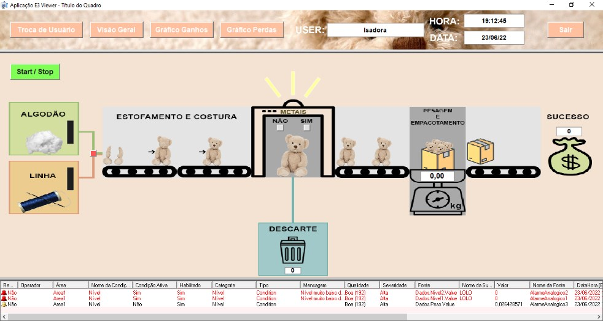
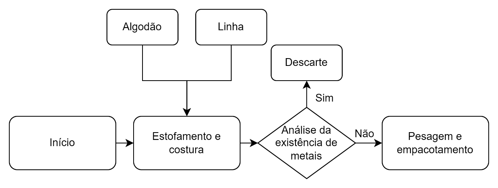
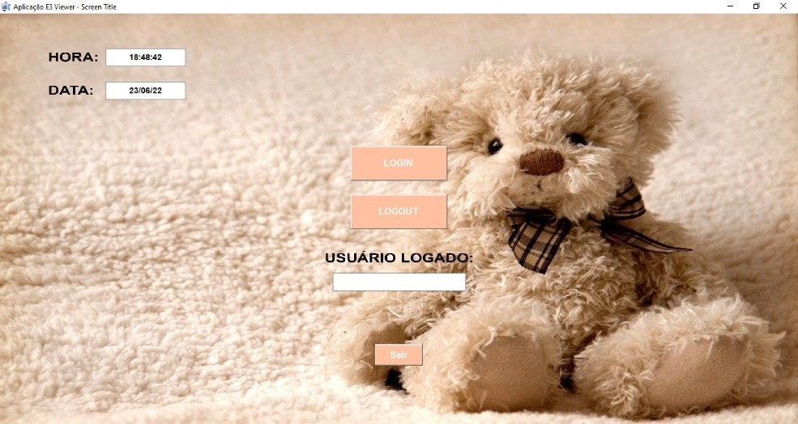
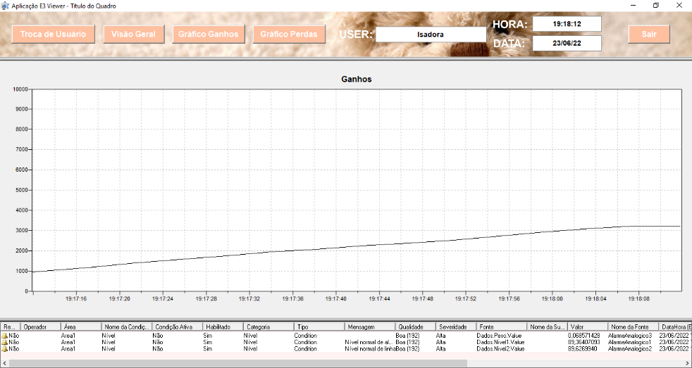
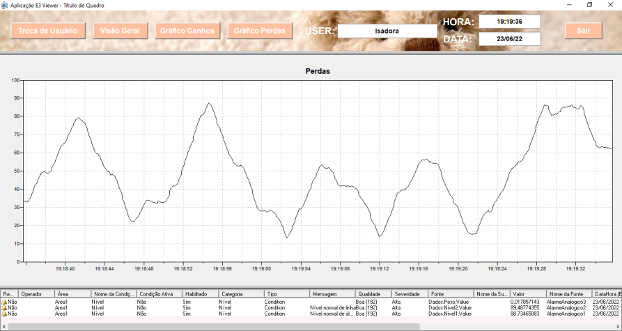

# Supervisório de uma linha de ursos de pelúcia (Elipse E3)

Sistema supervisório (SCADA) desenvolvido no **Elipse E3** para simular e monitorar uma linha de produção de ursos de pelúcia, com detecção de metais, descarte, pesagem e empacotamento. Foi o projeto da disciplina de Controle Supervisório, do curso de Engenharia Eletrônica da UTFPR, em 2022.

> **English:** SCADA project built with Elipse E3 (2022, Supervisory Control course at UTFPR). It simulates a teddy bear production line with metal detection, rejection, weighing and packing, and includes user login, alarms and trend charts.

## Por que esse processo

Brinquedos de pelúcia passam por muitas etapas manuais, como costura, estofamento e acabamento. Por isso existe o risco de agulhas ou pedaços de metal ficarem dentro do brinquedo, o que é perigoso para uma criança. O supervisório simula uma linha que inspeciona cada urso antes do empacotamento e descarta os que contêm metal.

## Telas

**1. Tela inicial.** Login e logout de usuário, hora e data atuais e botão de saída.

**2. Visão geral.** Botão de iniciar e pausar o processo, controle da entrada de algodão e linha, detector de metais, contadores de ursos empacotados e descartados e animação dos ursos na esteira.

**3. Gráfico de ganhos.** Acompanhamento dos empacotamentos bem-sucedidos ao longo do tempo.

**4. Gráfico de perdas.** Acompanhamento dos descartes.

Todas as telas, exceto a inicial, têm um menu superior (troca de tela, usuário logado, hora, data e saída) e uma janela de alarmes na parte inferior.

| Gráfico de ganhos | Gráfico de perdas |
|---|---|
|  |  |

## Recursos do E3 usados

- **TAGs** para simular o processo, como hora e data, início e pausa, movimento dos ursos, níveis de algodão e linha, detecção de metais, pesagem, descartes e empacotamentos
- **Alarmes** para nível baixo (10%) e alto (90%) de algodão e de linha, e para peso próximo ao de empacotamento (3 kg)
- **Usuários com níveis de acesso** diferentes, um administrador e um convidado
- **Gráficos de tendência** para ganhos e perdas
- **Animações** feitas com imagens editadas para o projeto

## Como abrir

O projeto precisa do **Elipse E3** (E3 Studio para editar e E3 Viewer para executar).

1. Abra o arquivo `SupervisorioUrsinhos.dom` no E3 Studio. Ele carrega o projeto `SupervisorioUrsinhos.prj`.
2. Execute o domínio e abra a aplicação no E3 Viewer.
3. Faça login com um dos usuários de teste configurados no domínio.

## O que eu faria diferente hoje

A principal dificuldade foi sincronizar as variáveis do processo, e dois problemas ficaram sem solução na entrega.

- **Detecção de metais fora de hora.** A detecção podia acontecer mesmo com o estofamento e a costura parados. Eu condicionaria a detecção à presença de um urso no detector.
- **Estados conflitantes.** Os botões "metal" e "sem metal" podiam ficar ativos ao mesmo tempo. Eu usaria uma única TAG com dois estados, o que impede a contradição.
- **Descarte por peso.** A ideia original era descartar também os ursos com peso fora do padrão, mas ela foi retirada por causa dos problemas de sincronização. Com os dois ajustes acima, daria para implementar.

---

Desenvolvido por **Isadora Fernanda Zappe Schmidt** · [LinkedIn](https://www.linkedin.com/in/isadora-fernanda)
